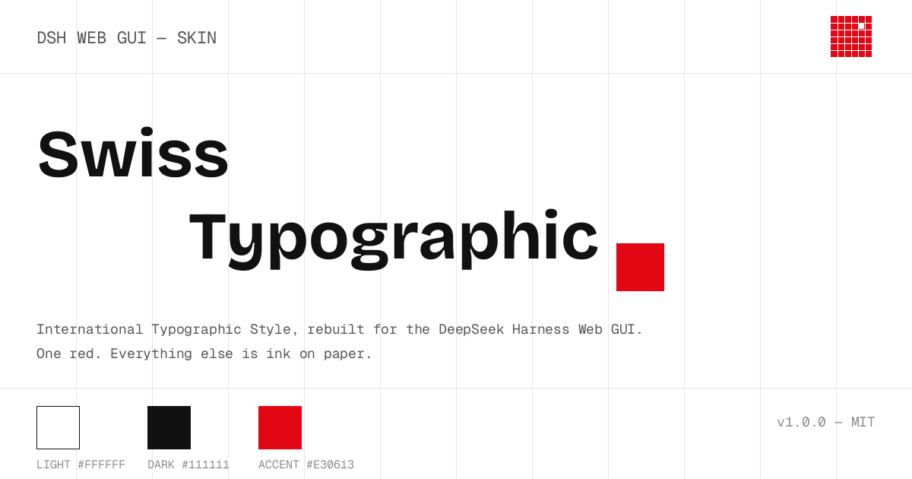
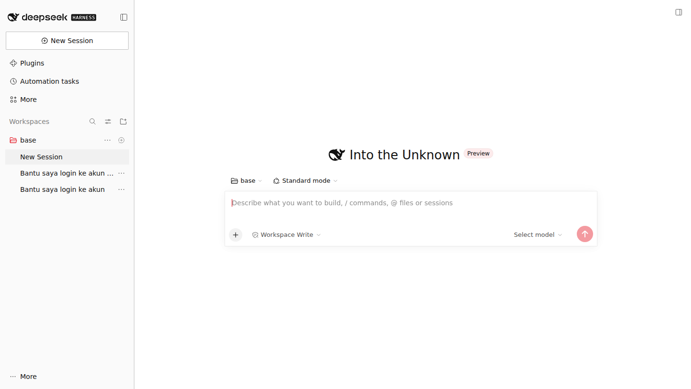
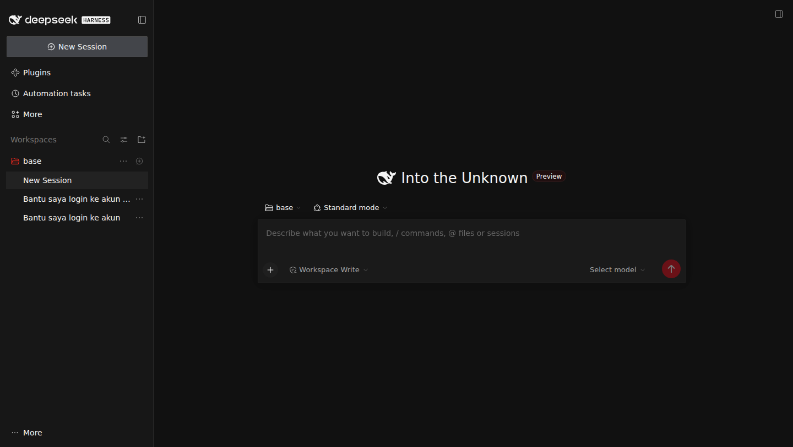

# Swiss Typographic — a DSH skin

[](https://github.com/0xmrxp/dsh-skin-swiss-typographic/actions/workflows/validate.yml)


**International Typographic Style, rebuilt for the [DeepSeek Harness](https://github.com/deepseek-ai/deepseek-harness) Web GUI.**

One red. Everything else is ink on paper.

<p align="center">
  
</p>

| Light — paper | Dark — print shop |
| --- | --- |
|  |  |

## Design language

This skin applies the rules of Swiss / International Typographic Style
(Müller-Brockmann's grid, the Ulm school's restraint) to a chat interface:

| Principle | Implementation |
| --- | --- |
| **One accent** | `#E30613` (light) / `#FF2A1F` (dark). Brand, primary buttons, focus rings, active states. Nothing else gets color. |
| **The grid is the decoration** | Hairline borders (`1px` rules) replace floating cards and soft shadows. Sections are separated by ruled lines, not elevation. |
| **Flatness** | Radius ladder pressed to 0–2px. No blur. Shadows reduced to a hairline stroke plus a barely-there lift. |
| **Typographic hierarchy** | Helvetica Neue first (native on macOS), Inter as the modern stand-in, full CJK fallback chain. Monospace stays monospace. |
| **Light + dark** | Light is paper (`#ffffff` canvas, ink `#111111`). Dark is the print shop (`#111111` canvas, ink `#f5f5f5`). The red survives both. |

## Install

### From the DSH skin directory (recommended)

```sh
git clone https://github.com/0xmrxp/dsh-skin-swiss-typographic.git
cd dsh-skin-swiss-typographic/skins/swiss-typographic

# using the dsh-skins tooling
node scripts/dsh-skin.cjs install . 
node scripts/dsh-skin.cjs use swiss-typographic
```

### Manual

Copy `skins/swiss-typographic/` into `$DSH_HOME/skins/` (default:
`~/.dsh/skins/`), then pick **Swiss Typographic** from the **Skins** tab in
the Web UI settings. Requires the skin-center plugin
(`@linxin666/dsh-web-all` bundle).

## Compatibility

- DSH ≥ 0.2.2-rc.1, skin manifest **v2**
- CSS-only: no hooks, no executable code, no background media
- Validated against the official skin contract (`dsh-skin validate`: **PASS**)
- All selectors follow `semantic-attrs/v1` — no hash-class selectors, so the
  skin survives upstream rebuilds

## Repository layout

```
skins/swiss-typographic/
├── skin.json      # v2 manifest (id, palette, contributions)
├── skin.css       # L1: full remap of the official --dsw-alias-* tokens
└── patches.css    # L3: the grid — flush edges, hairline rules, square inputs
```

## License

[MIT](./LICENSE) © 0xmrxp

"Swiss Style" / International Typographic Style is a historical design
movement; this skin is an original implementation inspired by its principles
and is not affiliated with or endorsed by any design institution or foundry.

## See also

- [dsh-web](https://github.com/zhu1090093659/dsh-web) — the DSH Web UI plugin ecosystem
- [dsh-skins](https://github.com/zhu1090093659/dsh-skins) — the community skin catalog and skin-center
- [Skin contract v2](https://github.com/zhu1090093659/dsh-skins/tree/main/contracts) — the authoritative skin manifest / CSS rules
