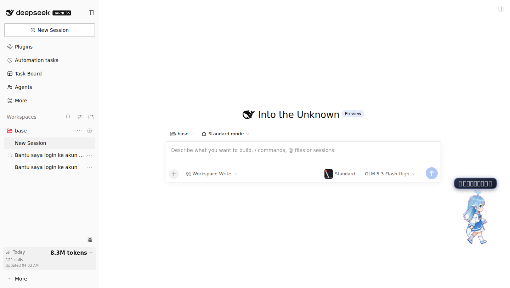
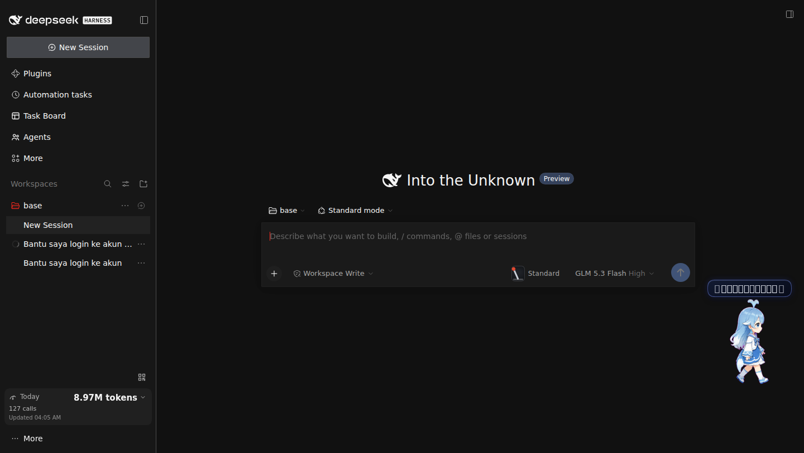

# Swiss Typographic — DSH 皮肤

[](https://github.com/0xmrxp/dsh-skin-swiss-typographic/actions/workflows/validate.yml)


**为 [DeepSeek Harness](https://github.com/deepseek-ai/deepseek-harness) Web GUI 重建的瑞士国际主义排版风格。**

一点红，其余皆是纸上墨迹。

| 浅色 —— 纸 | 深色 —— 印刷车间 |
| --- | --- |
|  |  |

## 设计语言

本皮肤将瑞士风格 / 国际主义排版风格（Müller-Brockmann 的网格、乌尔姆学院的克制）应用于聊天界面：

| 原则 | 实现 |
| --- | --- |
| **唯一强调色** | `#E30613`（浅色）/ `#FF2A1F`（深色）。品牌、主按钮、焦点环、活动状态 —— 其余一律无彩。 |
| **网格即装饰** | 发丝分隔线（`1px`）取代浮起卡片与柔和阴影，区块以横平竖直的规则线区隔，不靠海拔。 |
| **平面化** | 圆角阶梯压平至 0–2px，无模糊，阴影收敛为细描边加极浅投影。 |
| **排版层级** | 优先 Helvetica Neue（macOS 原生），Inter 为现代替身，完整 CJK 回退链；等宽保持等宽。 |
| **亮暗双主题** | 浅色是纸（画布 `#ffffff`，墨 `#111111`）；深色是印刷车间（画布 `#111111`，墨 `#f5f5f5`）。红在两种模式下都成立。 |

## 安装

### 通过皮肤目录（推荐）

```sh
git clone https://github.com/0xmrxp/dsh-skin-swiss-typographic.git
cd dsh-skin-swiss-typographic/skins/swiss-typographic

node scripts/dsh-skin.cjs install .
node scripts/dsh-skin.cjs use swiss-typographic
```

### 手动

将 `skins/swiss-typographic/` 复制到 `$DSH_HOME/skins/`（默认 `~/.dsh/skins/`），
然后在 Web UI 设置的 **Skins** 标签页选择 **Swiss Typographic**。
需要 skin-center 插件（`@linxin666/dsh-web-all` bundle）。

## 兼容性

- DSH ≥ 0.2.2-rc.1，skin manifest **v2**
- 纯 CSS：无 hooks、无可执行代码、无背景媒体
- 已通过官方皮肤契约校验（`dsh-skin validate`：**PASS**）
- 全部选择器遵循 `semantic-attrs/v1`，不含 hash 类名选择器，上游重建不失效

## 仓库结构

```
skins/swiss-typographic/
├── skin.json      # v2 manifest（id、调色板、贡献声明）
├── skin.css       # L1：官方 --dsw-alias-* 语义 token 全量重映射
└── patches.css    # L3：网格 —— 直角边缘、发丝分隔线、方角输入框
```

## 许可证

[MIT](./LICENSE) © 0xmrxp

"Swiss Style" / 国际主义排版风格为历史设计流派；本皮肤是基于其原则的原创实现，与任何设计机构或字库厂商无隶属或背书关系。

## 相关项目

- [dsh-web](https://github.com/zhu1090093659/dsh-web) —— DSH Web UI 插件生态
- [dsh-skins](https://github.com/zhu1090093659/dsh-skins) —— 社区皮肤目录与皮肤中心
- [皮肤契约 v2](https://github.com/zhu1090093659/dsh-skins/tree/main/contracts) —— manifest / CSS 规则权威来源
